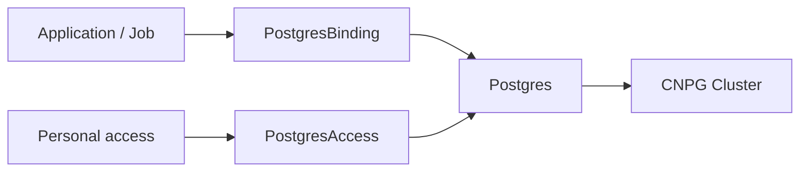

Nais Databases
==============

Nais runs managed PostgreSQL in team namespaces on Kubernetes. [pgrator](https://github.com/nais/pgrator) owns the Nais resource model and access policies; [CloudNativePG](https://cloudnative-pg.io/) (CNPG) operates PostgreSQL.

This page describes the platform architecture. For manifests, commands and supported options, use the [Postgres user documentation](https://doc.nais.io/persistence/postgres/). The [previous Zalando-based setup](postgres.md) is documented separately.

Resource model
--------------

The Postgres resources use `nais.io/v1`:

| Resource | Responsibility |
|----------|----------------|
| `Postgres` | A database. Directly owns its CNPG cluster, storage and backup resources. |
| `PostgresBinding` | Connects an Application or Job to a Postgres through database roles, connection Secrets and NetworkPolicies. |
| `PostgresAccess` | Grants a person time-limited access to a Postgres. |

Each Postgres is independent. Workloads and personal access reference the database directly.

Who owns what
-------------

**pgrator** translates the Nais resources into CNPG clusters, PgBouncer poolers, roles, credentials, network policies, monitoring and backup resources. It also manages Valkey and OpenSearch through Aiven; those do not use CNPG.

**CNPG** manages PostgreSQL pods, replication and failover. Its **Barman Cloud plugin** handles base backups and WAL archiving to Google Cloud Storage, and recovery from those archives. pgrator provisions the archive configuration and required cloud resources when archiving is enabled.

Deployment configuration lives in the [pgrator chart](https://github.com/nais/pgrator/tree/main/charts/pgrator) and the [CloudNativePG feature](https://github.com/nais/helm-charts/tree/main/features/cloudnative-pg), rather than being duplicated here.

Workload and personal access
---------------------------

For workloads, Naiserator creates `PostgresBinding` resources from Application and Job declarations. pgrator supplies database credentials using client certificates and limits network access to the relevant workloads. Workloads consume connection Secrets rather than managing CNPG roles themselves.

For people, the Nais API authorizes the request and creates a `PostgresAccess`. pgrator prepares a personal database role, short-lived password and a `RelayAccess` mapping for the selected database. The CLI exposes a local listener and forwards traffic through [relay](https://github.com/nais/relay); PostgreSQL TLS remains end-to-end.

Platform login authorizes the access request; PostgreSQL authenticates the personal connection with SCRAM credentials, not OAuth. Access expires without deleting database objects owned by the personal role. Expiry is not a hard cutoff for existing SQL sessions.

Backup and recovery
-------------------

Base backups and archived WAL support point-in-time recovery (PITR). Recovery creates a new, independent Postgres with the source database's data at an explicitly selected time. It does not overwrite the source or move applications.

Using the recovered database requires explicitly updating workload references. This is not an in-place restore or an automatic cutover. See the [PITR contract](https://github.com/nais/pgrator/blob/main/doc/postgres-pitr.md) for recovery constraints and lifecycle details.

Sources of truth
----------------

- [Postgres user documentation](https://doc.nais.io/persistence/postgres/): supported usage and operational guides.
- [pgrator](https://github.com/nais/pgrator): implementation, resource contracts and architecture decisions.
- [CNPG documentation](https://cloudnative-pg.io/documentation/current/): PostgreSQL cluster operations.
- [Barman Cloud plugin](https://cloudnative-pg.io/plugin-barman-cloud/): backup and recovery internals.
