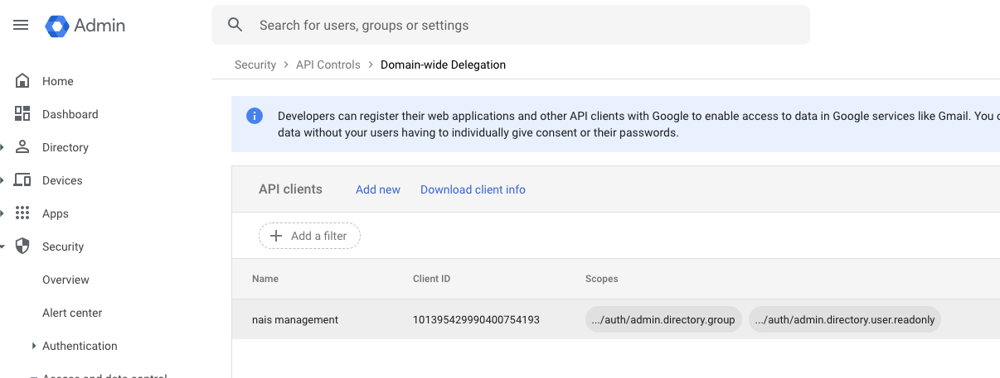

# Step 5 - Tenant: post terraforming

!!! note
    This step is done by the tenant administrators.

### Set up domain-wide delegation (in tenant admin.google.com)

Nais performs some operations on behalf of the Nais admin user mentioned above. For this to work the, this user needs domain-wide delegation with some scopes. This must be manually set up in the Google Admin console:

1. Go to [https://admin.google.com/ac/owl/domainwidedelegation](https://admin.google.com/ac/owl/domainwidedelegation)
1. Get the client ID of the tenant directory service account
    ```bash title="Using gcloud"
    MANAGEMENT_PROJECT_ID=<tenant management project>
    gcloud iam service-accounts --project=$MANAGEMENT_PROJECT_ID describe tenant-directory-sa@$MANAGEMENT_PROJECT_ID.iam.gserviceaccount.com --format="value(uniqueId)"
    ```
1. Click on `Add new` to add a new Client ID
1. Add the following scopes:
    - `https://www.googleapis.com/auth/admin.directory.group`
    - `https://www.googleapis.com/auth/admin.directory.user.readonly`
1. Click on `Authorize`

After this is done you should see something like the following:



1. We recommend enabling [Google Access Approval](https://docs.cloud.google.com/assured-workloads/access-approval/docs/overview) for your organization. 
   This will log Google Access to your resources and require Google to get approval before accessing them.

### Re-enable domain restricted sharing (optional)

During onboarding domain restricted sharing was disabled.
You may now re-enable it, with two exceptions:

- The `nais-management-xxxx` project must still allow service accounts from other domains, as well as public resources (`allUsers` and `allAuthenticatedUsers`).
- The Nais folder must allow `nais.io` users, otherwise the Nais team can not grant them self admin in the projects.

To allow nais.io on just the Nais folder, while keeping the rest of the organization restricted:

```yaml title="nais-drs.yaml"
name: folders/<NAIS_FOLDER_ID>/policies/iam.allowedPolicyMemberDomains
spec:
  inheritFromParent: true
  rules:
    - values:
        allowedValues:
          - is:C00xgb366 # nais.io Cloud Identity customer ID
```

```bash
gcloud org-policies set-policy nais-drs.yaml
```

The `inheritFromParent` setting merges this exception with your organization-wide policy instead of replacing it.

### Export billing data (tenants with their own billing account)

To present your cost data in Nais Console, your Cloud Billing data must be exported to a BigQuery dataset.

1. Set up [Cloud Billing data export to BigQuery](https://docs.cloud.google.com/billing/docs/how-to/export-data-bigquery-setup)
    - We recommend creating a dedicated project for this export
    - Enable the **Detailed usage cost data** export
1. When the dataset is created, grant `nais-billing@nais.io` the `BigQuery Data Viewer` role on the dataset
1. Notify the Nais team and include the project ID and dataset name
